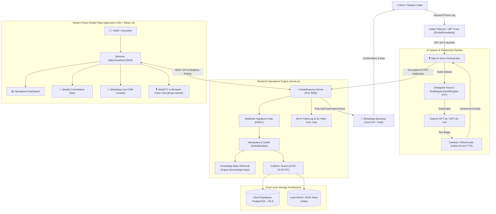

# Codevirus Security — AI Operations Suite: Master Standard Operating Procedure (SOP) & Runbook
**Codevirus Security Private Limited & Codevirus Academy**  
*Campus: Kapoorthala, Aliganj, Lucknow, Uttar Pradesh, India*  
*Document Version: 2.1.0 — Production Ready*

---

## 1. Executive Architecture & Component Map

The platform provides an end-to-end autonomous AI voice receptionist, lead qualification, consultation scheduling, and WhatsApp CRM platform specifically engineered for Indian telecom and bilingual (Hindi/Hinglish/English) callers.



### Complete Codebase Inventory

| File / Directory | Category | Description |
|---|---|---|
| [`server.js`](file:///c:/voice%20code%20virus/server.js) | Backend Core | Express server, webhook verification, dual-layer DB synchronization, REST APIs, static asset serving |
| [`start.js`](file:///c:/voice%20code%20virus/start.js) | Orchestration | Master unified launcher: auto-starts backend, tunnel, Vapi patch, and opens React browser |
| [`start.bat`](file:///c:/voice%20code%20virus/start.bat) | Automation | 1-Click Windows execution script |
| [`setup.js`](file:///c:/voice%20code%20virus/setup.js) | Provisioning | Creates/updates Vapi Sarah Assistant with system prompt, multilingual models, and tools |
| [`local-store.js`](file:///c:/voice%20code%20virus/local-store.js) | Database | Thread-safe atomic JSON persistence store for offline or Supabase fallback |
| [`create_tables.js`](file:///c:/voice%20code%20virus/create_tables.js) | Database | Supabase PostgreSQL schema provisioning and table migration script |
| [`supabase_setup.sql`](file:///c:/voice%20code%20virus/supabase_setup.sql) | Database | SQL schema, indexes, and Row-Level Security (RLS) policies |
| [`reset-demo.js`](file:///c:/voice%20code%20virus/reset-demo.js) | Operations | Wipes test artifacts and reseeds clean demo consultations |
| [`test-suite.js`](file:///c:/voice%20code%20virus/test-suite.js) | QA / CI | 5-phase test harness covering syntax, static serving, REST APIs, and security |
| [`scenario-test-suite.js`](file:///c:/voice%20code%20virus/scenario-test-suite.js) | QA / CI | 11 real-world behavioral scenario tests (Hindi/Hinglish, idempotency, escalation) |
| [`ecosystem.config.js`](file:///c:/voice%20code%20virus/ecosystem.config.js) | Production | PM2 process configuration for 24/7 background uptime |
| [`nginx.conf`](file:///c:/voice%20code%20virus/nginx.conf) | Production | Production reverse proxy configuration with TLS and rate limiting |
| [`windows-service.js`](file:///c:/voice%20code%20virus/windows-service.js) | Production | Native Windows Service installer |
| [`frontend/`](file:///c:/voice%20code%20virus/frontend) | Frontend App | Vite + React 19 SPA source code, components, styles, and distribution bundle |
| [`knowledge-base/`](file:///c:/voice%20code%20virus/knowledge-base) | Intelligence | 4 verified knowledge documents (courses, VAPT, campus, FAQs) |
| [`data/`](file:///c:/voice%20code%20virus/data) | Runtime Cache | Active JSON store for appointments, dormant leads, activity, and messages |

---

## 2. Prerequisites & Credentials Checklist

Ensure all credentials exist in your production environment variables or local [`.env`](file:///c:/voice%20code%20virus/.env):

```env
PORT=3000
NODE_ENV=production

# ── Vapi AI Voice Platform (vapi.ai) ──────────────────────────
VAPI_PRIVATE_KEY=vapi_sec_xxxxxxxxxxxxxxxxxxxx
VAPI_PUBLIC_KEY=vapi_pub_xxxxxxxxxxxxxxxxxxxx
VAPI_WEBHOOK_SECRET=vapi_whsec_xxxxxxxxxxxxxxxxx
ASSISTANT_ID=399183dd-b23a-4558-a0d1-c3646fa3f8f9
PHONE_NUMBER_ID=89cefd49-3647-4df2-90c2-f1419972c3a7

# ── Telephony & Human Escalation ──────────────────────────────
INDIA_PHONE_NUMBER=+919648777706
TWILIO_NUMBER=+919648777706

# ── OpenAI Language Intelligence ──────────────────────────────
OPENAI_API_KEY=sk-proj-xxxxxxxxxxxxxxxxxxxx

# ── Supabase Cloud PostgreSQL ─────────────────────────────────
SUPABASE_URL=https://your-project.supabase.co
SUPABASE_SERVICE=eyJhbGciOi...
SUPABASE_ANON_KEY=eyJhbGciOi...

# ── Meta / Twilio WhatsApp API ────────────────────────────────
WHATSAPP_TOKEN=EAAG...
WHATSAPP_PHONE_NUMBER_ID=100xxxxxxxxxxxx
WHATSAPP_VERIFY_TOKEN=codevirus_wa_verify_2026
TWILIO_ACCOUNT_SID=ACxxxxxxxxxxxxxxxxxxxxxxxx
TWILIO_AUTH_TOKEN=xxxxxxxxxxxxxxxxxxxxxxxxxxxx
```

---

## 3. Step-by-Step Initial Setup Procedure

### Step 1: Install Dependencies
```bash
# Install backend dependencies
npm install

# Install frontend React dependencies
npm --prefix frontend install
```

### Step 2: Initialize Database Schema
Run table creation and initial dataset seeding in Supabase:
```bash
node create_tables.js
```

### Step 3: Configure Vapi AI Assistant
Provision the AI Assistant ("Sarah — Codevirus Security") with Deepgram `nova-2` multilingual speech recognition, tool declarations, and Hindi/Hinglish conversational rules:
```bash
node setup.js
```

### Step 4: Build React Single-Page Application
Compile the React bundle into `frontend/dist`:
```bash
npm run build
```

---

## 4. Execution & Launch Procedures

### Procedure A: 1-Click Launch (Windows Development / Demo)
Double-click [`start.bat`](file:///c:/voice%20code%20virus/start.bat) or run:
```bash
node start.js
```
*What happens automatically:*
1. Checks and frees port 3000 if occupied.
2. Boots the Express API server.
3. Establishes the public HTTPS webhook tunnel.
4. Updates Vapi with the active webhook URL.
5. Launches `http://localhost:3000/` in the default web browser.

### Procedure B: 24/7 PM2 Production Daemon (Linux VPS / Cloud Host)
```bash
# Start background services
npx pm2 start ecosystem.config.js

# Save process list across server reboots
npx pm2 save

# Monitor live logs
npx pm2 logs
```

### Procedure C: Docker Container Deployment
```bash
# Build and start container in detached mode
docker-compose up -d --build

# Inspect container status
docker-compose ps
```

### Procedure D: Windows Native Background Service
To install Codevirus AI Suite as a service that starts on Windows boot without any user logged in:
```bash
npm install -g pm2 pm2-windows-service
pm2-service-install
pm2 start ecosystem.config.js
pm2 save
```

---

## 5. Day-to-Day Operational Workflows

### 5.1 Inbound Call Reception Flow
1. **AI Disclosure & Welcome**: Sarah answers within 2 rings, announces herself as Codevirus AI voice coordinator, and mentions the call may be recorded for quality.
2. **Language Mirroring**:
   - If caller speaks **Hindi**, Sarah replies in polite, clear Hindi.
   - If caller speaks **Hinglish**, Sarah replies in natural conversational Hinglish.
   - If caller speaks **English**, Sarah uses clear Indian English.
3. **Knowledge Retrieval**: When questions arise regarding courses, syllabus, fees, or location, Sarah executes `search_knowledge` against the verified markdown documents in [`knowledge-base/`](file:///c:/voice%20code%20virus/knowledge-base).
4. **Booking & Collision Guard**:
   - Sarah collects candidate name, phone number, and preferred slot (10:00 AM – 10:00 PM IST).
   - Backend checks double-booking collisions via `parseTimeToMinutes()`.
   - Confirms booking and returns a structured calendar confirmation.
5. **Post-Call WhatsApp Confirmation**: Upon call termination, the backend end-of-call handler automatically dispatches an instant WhatsApp message to the candidate with appointment time, counselor name, and Kapoorthala campus map coordinates.

### 5.2 Human Escalation & Transfer Flow
Sarah immediately invokes `transfer_call` and patches the call to `+919648777706` if:
- Caller explicitly asks for a human counselor or senior director.
- Caller expresses frustration or has a grievance.
- Urgent active cybersecurity breach or enterprise incident reported.
- Scoping enterprise VAPT contracts requiring custom legal agreements.

### 5.3 Automated Recovery & Follow-up Routines
- **No-Show Recovery**: Clicking "No-Show" in the React Dashboard triggers Sarah to dial the candidate's phone within 5 seconds to offer rescheduling.
- **48-Hour Follow-Up Cron**: Scans completed consultations and initiates a check-in call asking if the candidate has any questions about curriculum or batch start dates.
- **Dormant Reactivation**: Prospects with over 30 days of inactivity can be batch-dialed by Sarah with a single click in the Dashboard.

---

## 6. Indian Telephony & TRAI Compliance Setup

```
[Inbound Mobile Call] 
       ↓
[Indian Telco / SIP Trunk: Exotel / Knowlarity / Ozonetel] 
       ↓ (SIP Trunking via G.711u / Opus)
[Vapi BYO SIP Trunk] 
       ↓
[Sarah AI Voice Assistant]
```

### Setup Steps for Permanent Indian Number:
1. **Complete Business KYC**: Submit Company PAN, GST registration, Certificate of Incorporation, and authorized signatory Aadhaar to the Indian telecom partner (Exotel, Knowlarity, or Ozonetel).
2. **Provision SIP Trunk**: Request an inbound-only SIP trunk pointed to Vapi's SIP domain: `sip.vapi.ai`.
3. **Configure in Vapi Dashboard**:
   - Go to **Phone Numbers** -> **Import / BYO SIP**.
   - Input your Indian number (e.g., `+919648777706`).
   - Attach the **Sarah — Codevirus Security** assistant.
4. **TRAI Compliance**:
   - Inbound calling requires no DLT registration.
   - For outbound campaigns (/trigger-outbound), ensure promotional calling happens only between 10:00 AM and 8:00 PM IST, and scrub against the National Do Not Call (DND) registry.

---

## 7. Security Hardening & Protection Runbook

- **Webhook Signature Gate**: Every payload to `/webhook` is authenticated with HMAC-SHA256 signature verification via `VAPI_WEBHOOK_SECRET`. Unsigned calls are rejected with 401 Unauthorized.
- **Idempotency Deduplication**: Duplicate tool calls from cellular packet re-transmission are deduplicated via in-memory cache, preventing double-bookings.
- **Protected Static File Whitelist**: Direct browser requests to `.env`, `.git`, `server.js`, `package.json`, or `data/*.json` are blocked with 403 Forbidden.
- **HTTP Security Headers**: Enforced via Helmet:
  - `X-Content-Type-Options: nosniff`
  - `X-Frame-Options: SAMEORIGIN`
  - `X-XSS-Protection: 1; mode=block`
  - `X-Powered-By` fingerprint header disabled.
- **API Rate Limiting**:
  - General API: 120 req / 15 min.
  - Chat reply endpoint: 40 req / 1 min.
  - CSV exports: 30 req / 1 hr.

---

## 8. Verification, Testing & QA Procedures

Always execute the automated verification test harness before deploying updates:

```bash
# 1. Run Core Integration & Security Test Suite (5 Sections)
node test-suite.js

# 2. Run Real-World Scenario Harness (11 Behavioral Tests)
node scenario-test-suite.js
```

### Acceptance Criteria Checklist
- [x] Syntax check passes on all scripts (`node -c`).
- [x] Static routes `/`, `/logo-navy.png`, `/config` return HTTP 200.
- [x] Legacy `.html` routes redirect seamlessly to React single-page app.
- [x] Knowledge search returns verified markdown answers.
- [x] Double-booking collision detection returns 409 Conflict.
- [x] Webhook idempotency test drops duplicate packets.
- [x] Sensitive files (`.env`, `server.js`) return HTTP 403.
- [x] System health endpoint (`/health`) returns `{ status: "ok" }`.

---

## 9. Disaster Recovery & Troubleshooting Guide

| Symptom | Root Cause | Immediate Resolution |
|---|---|---|
| `EADDRINUSE: address already in use :::3000` | Stale Node process holding port 3000 | In PowerShell, run: `Stop-Process -Id (Get-NetTCPConnection -LocalPort 3000).OwningProcess -Force` |
| `Supabase fetch error / network unreachable` | Cloud database connectivity drop | Backend automatically switches to local atomic storage ([`local-store.js`](file:///c:/voice%20code%20virus/local-store.js)). Check Supabase project status in dashboard. |
| `React frontend returns 500 missing bundle` | `frontend/dist` was cleaned or not compiled | Run `npm run build` from workspace root. Bundle generates in < 1 second. |
| `Localtunnel disconnects or changes URL` | Free tunnel ephemeral nature | Run `node update-tunnel.js` to re-establish and re-sync Vapi assistant. For production, deploy behind static domain via `nginx.conf`. |
| `Vapi call drops immediately on answer` | Invalid Assistant ID or private key | Verify `ASSISTANT_ID` and `VAPI_PRIVATE_KEY` in [`.env`](file:///c:/voice%20code%20virus/.env), then run `node setup.js`. |

